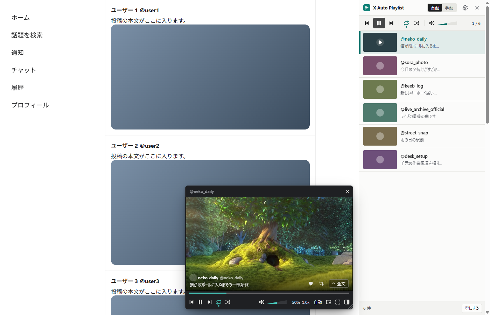
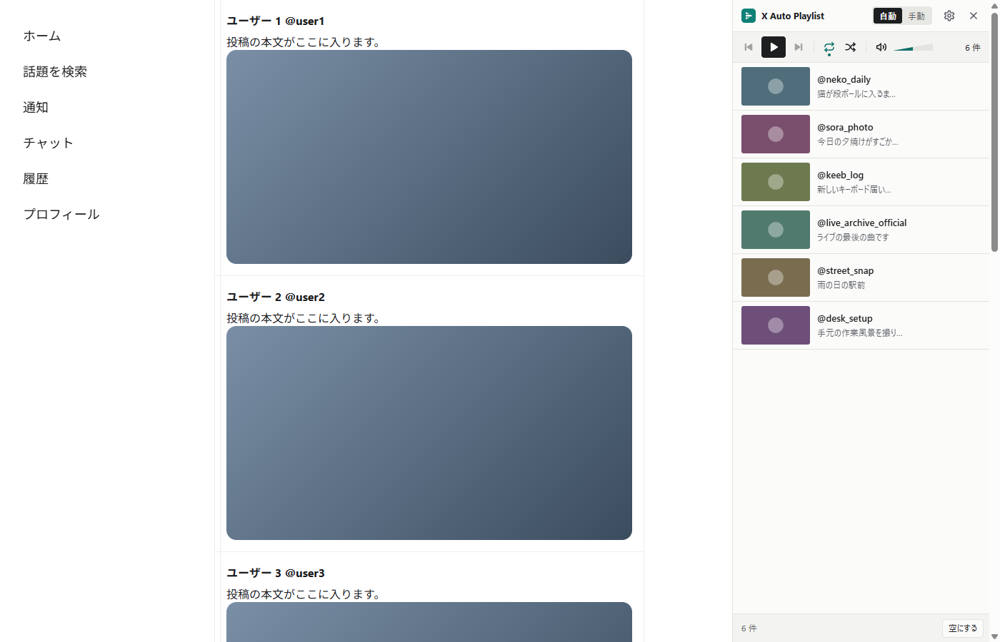
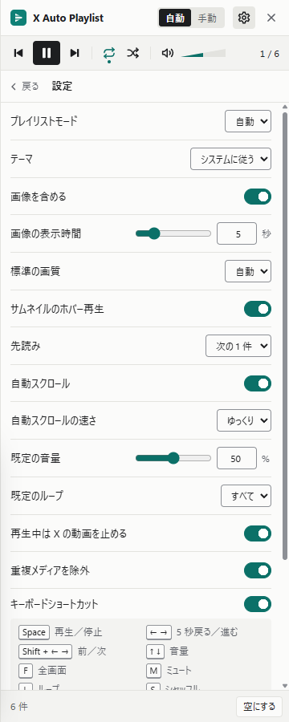

# X Auto Playlist

X（旧 Twitter）のタイムラインに流れてくる動画や画像を、**プレイリストにしてまとめて見る** ための Google Chrome 拡張機能です。

X を開いたまま、画面の右側にプレイリストのパネルが並び、動画は小さな再生ウィンドウで次々に再生されます。音楽プレイヤーで曲を流すように、X の動画を流し見できます。

## こんなときに

- タイムラインの動画を 1 本ずつタップして開くのが面倒
- 「いいね」や「ブックマーク」にためた動画を、あとでまとめて見たい
- 作業の脇で X の動画を BGM 代わりに流しておきたい

## できること

**自動でプレイリストを作る**
開いているページ（ホーム、ブックマーク、いいね、ユーザーのメディア、検索結果）に並んでいる動画や画像が、自動でプレイリストに入ります。再生が一覧の終わり近くまで進むと、ページを少しずつ自動でスクロールして続きを読み込みます。

**自分でプレイリストを作る**
気になった投稿を右クリックして「プレイリストに追加」または「次に再生」を選ぶと、手動のプレイリストに入ります。1 つの投稿に写真が 4 枚あれば 4 枚とも入ります。手動のプレイリストはブラウザを閉じるまで残り、前回止めたところから再開できます。

**再生ウィンドウ**
再生・一時停止、前後の移動、くり返し（全体／1 本だけ）、シャッフル、シークバー、音量（マウスを乗せてホイールでも変えられます）、再生速度、画質（自動、または投稿にある解像度から選択）、小窓再生（ピクチャ・イン・ピクチャ）、全画面。全画面にしてもプレイリストはそのまま横に出しておけます。
投稿者と本文も表示され、「全文」を押すと本文を全部読めます。その投稿に「いいね」や「リポスト」もできます。

**プレイリストのパネル**
サムネイルにマウスを乗せると冒頭が動きます。項目をダブルクリックするとそこから再生、ドラッグで順番の入れ替え（手動のときのみ）、「⋮」から削除・次に再生・元の投稿を開く、ができます。再生済みの項目は薄く表示するか、自動で消すかを選べます。

**設定**
パネルの歯車から変えられます。自動／手動の切り替え、見た目（ライト／ダーク／端末に合わせる）、画像をプレイリストに含めるか、画像を表示する秒数、標準の画質、先読み、自動スクロール、既定の音量とくり返し、再生中に X 側の動画を止めるか、同じ動画をまとめるか、キーボード操作、再生済みの扱い、いいね／リポストのボタンを出すか。

**キーボード操作**（再生ウィンドウが出ているとき）

| キー | 動き |
|---|---|
| Space | 再生／一時停止 |
| ← → | 5 秒戻る／進む |
| Shift + ← → | 前の項目／次の項目 |
| ↑ ↓ | 音量 |
| F | 全画面 |
| M | ミュート |
| L | くり返しの切り替え |
| S | シャッフル |
| P | 小窓再生 |

文字を入力しているときは、これらのキーは効きません。

## インストール

Chrome ウェブストアでは配布していません。ファイルを直接 Chrome に読み込みます。

1. このページの右側にある **Releases** から、最新の `x-auto-playlist-〇〇-chrome.zip` をダウンロードします。
2. zip を展開します（フォルダができます）。
3. Chrome のアドレス欄に `chrome://extensions` と入力して開きます。
4. 右上の **「デベロッパーモード」** をオンにします。
5. **「パッケージ化されていない拡張機能を読み込む」** を押し、2 で展開したフォルダを選びます。
6. ツールバーに青緑のアイコンが出れば完了です（見当たらないときはパズルのアイコンから固定してください）。

更新するときは、新しい zip を同じ場所に展開し、`chrome://extensions` で拡張機能の「更新」（丸い矢印）を押します。

## 使い方

1. X（x.com）にログインして、ホームや「履歴」（ブックマーク／いいね）を開きます。
2. ツールバーのアイコンをクリックすると、右側にパネルが開き、そのページの動画や画像が並びます。
3. パネルの **再生ボタン** を押すか、項目を **ダブルクリック** すると再生が始まります。項目が増えただけでは勝手に再生は始まりません。
4. 右クリックで追加した項目は、パネル上部の **「手動」** に切り替えると見られます。
5. パネルとページの境目をドラッグすると、パネルの幅を変えられます。パネルを閉じるときは右上の「×」か、もう一度ツールバーのアイコンを押します。

## 知っておいてほしいこと

- **非公式のツールです。** X 社とは関係ありません。X の中の仕組みを使っているため、X 側の変更で突然動かなくなることがあります。そのときはパネルに「X から情報を取得できません」と出ます。
- **ブックマークは再生ウィンドウからは付けられません**（X 側の制限のため）。X の画面で普段どおり操作してください。
- 「いいね」や「リポスト」を短時間に何度もくり返すと、X に自動操作とみなされて拒否されることがあります。その場合は少し時間を置いてください。
- ライブ配信の録画など、一部の動画は再生できず「再生不可」と表示されます。
- 小さな再生ウィンドウでは画質が自動で低めになります。くっきり見たいときは画質メニューから選んでください。
- X にログインしていないと動画は集まりません。
- 動画や画像を保存する機能はありません。

## 開発者向け

仕組みや開発手順は [docs](docs/) にまとめています（[要件](docs/requirements.md)、[設計](docs/architecture.md)、[最終確認](docs/final_check.md)、[リリースノート](docs/release_notes.md)）。自分でビルドする場合は Node.js 22 以上で `npm install` → `npm run build` を実行し、`.output/chrome-mv3` を読み込みます。

## ライセンス

未定です（公開前に `LICENSE` を追加してください）。
